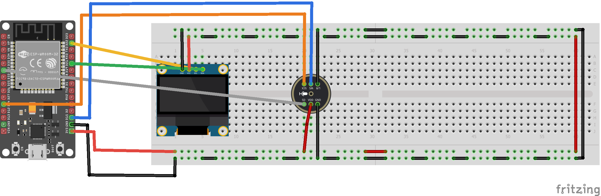

# Shazamzinho

Projeto de reconhecimento de músicas com ESP32, Olaf e .NET. O backend já reconhece trechos de áudio reais. A captura pelo ESP32 está em desenvolvimento.



[Arquivo do Fritzing](docs/fritzing/Shazamzin.fzz) · [Guia de montagem](docs/fritzing/README.md)

## Rodar a API

Com o SDK .NET 10 instalado e o Docker aberto, execute na raiz do projeto:

```powershell
./scripts/setup-valkey.ps1
dotnet run --project backend/src/Shazamzin.Api --launch-profile http
```

Abra a [documentação interativa da API](http://localhost:5184/docs).

[Ingestão de músicas](docs/ingestion.md) · [Arquitetura](docs/architecture.md)
