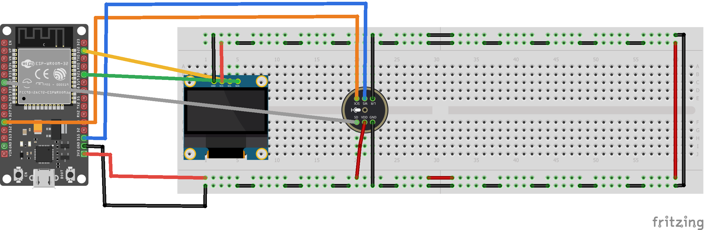

# Shazamzinho

## Integrantes

- Miguel Mussalam Silva (Matrícula 1123299)
- Thiago Danilow de Araujo (Matrícula 9979454)
- Pedro de França Pereira (Matrícula 8165880)
- João Pedro Thomaz Kairalla dos Santos (Matrícula 6898366)
- Joaquim Luiz Malacarne Lima de Oliveira (Matrícula 4418635)

## Projeto

Reconhecimento de músicas com ESP32. O ESP32 capta o som por um microfone INMP441, gera as
impressões digitais do áudio (fingerprints) com o Olaf no próprio chip e manda para uma API
em .NET, que procura a música num catálogo e devolve título e artista para o display OLED.
O código que roda no hardware está na pasta [firmware](firmware/).

