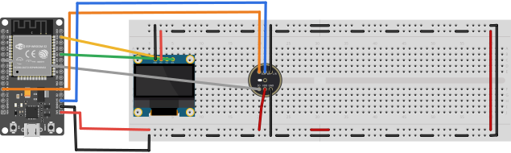

# Planta Fritzing — Shazam-ESP32

`Shazamzin.fzz` contém a montagem em protoboard do **ESP32 DevKit V1 (30 pinos),
INMP441 e OLED SSD1306**.

## Ajustes em relação à montagem anterior

Com o ESP32 desligado, ajuste o microfone e os jumpers:

1. Passe o INMP441 para o vão central. A fileira `SCK`, `WS`, `L/R` ocupa `E20–E22`
   e a fileira `SD`, `VDD`, `GND` ocupa `F20–F22`. Cada fileira fica em uma metade
   eletricamente separada da protoboard.
2. Ligue `L/R` ao trilho de GND acima do microfone, na posição `W22` do desenho.
   Isso seleciona o canal esquerdo. [Datasheet do INMP441](https://product.tdk.com/system/files/dam/doc/product/sw_piezo/mic/mems-mic/data_sheet/inmp441.pdf)
3. Acrescente as pontes que faltavam nas interrupções centrais. No trilho superior
   de GND, ligue `W29` a `W32`. No trilho inferior de 3,3 V, ligue `Y29` a `Y32`.
   O desenho já inclui as outras duas pontes centrais e os dois jumpers da
   extremidade direita que unem os trilhos de cima e de baixo.

Antes de alimentar a montagem física, confira com um multímetro a continuidade
dos trilhos e a separação entre 3,3 V e GND. Use os nomes impressos nos módulos
para conferir a orientação dos pinos.

## Como abrir

As 3 peças usadas (ESP32, INMP441, OLED) **não vêm instaladas por padrão no Fritzing** —
são contribuições da comunidade. É um passo único:

1. Abra o Fritzing.
2. Arraste os 3 arquivos de `parts/` para a aba **MINE** da caixa de peças (parts bin),
   um de cada vez (ou use **Parts → Import...**):
   - `parts/ESP32 DevKit v1 30 pinos.fzpz`
   - `parts/INMP441.fzpz`
   - `parts/SSD1306 OLED 0.96in I2C.fzpz`
3. Abra `Shazamzin.fzz` (File → Open).
4. Vá na aba **Protoboard** para acompanhar a montagem.

A vista foi aberta no Fritzing 0.9.3b e as sete redes foram conferidas pelo grafo
de ligações, incluindo as conexões internas da protoboard. Nessa versão o contador
mostra `5 de 7`, mas clicar nele abre a confirmação de que não existem conexões
não roteadas nessa vista. [Registro de problema semelhante no Fritzing](https://github.com/fritzing/fritzing-app/issues/3616)

## Pinagem prevista

| Sinal | ESP32 | → | Destino |
|---|---|---|---|
| 3.3V | pino `3V3` | → | trilho **+** da protoboard |
| GND | pino `GND` | → | trilho **–** da protoboard |
| SDA (I²C) | `GPIO21` | → | OLED `SDA` (direto) |
| SCL (I²C) | `GPIO22` | → | OLED `SCL` (direto) |
| WS (I²S) | `GPIO15` | → | INMP441 `WS` (direto) |
| SCK (I²S) | `GPIO14` | → | INMP441 `SCK` (direto) |
| SD (I²S) | `GPIO32` | → | INMP441 `SD` (direto) |

Ligue `VCC` do OLED e `VDD` do microfone a 3,3 V. Ligue `GND` dos dois módulos
e `L/R` do microfone ao GND do ESP32. Use os segmentos da protoboard com
continuidade confirmada para distribuir a alimentação.

## Proveniência das peças (créditos)

Nenhuma peça foi desenhada do zero — todas são contribuições reais baixadas da
comunidade Fritzing, com moduleId/conectores conferidos no `.fzp` de cada uma antes de
montar o sketch:

- **ESP32 DevKit V1 (30 pinos)** — Werner Rothschopf, modificado por vanepp (dez/2018).
  [Fórum Fritzing](https://forum.fritzing.org/t/doit-esp32-devkit-v1/6158/8)
- **INMP441** — Graham Coulby (out/2020).
  [github.com/gcoulby/FritzingParts](https://github.com/gcoulby/FritzingParts)
- **SSD1306 0.96" 128x64 I²C** — Old_Grey / nekocodeX (out/2020), CC BY-NC-SA 3.0 (uso
  não comercial — ok para projeto acadêmico).
  [github.com/matiasfigue/Fritzing-Parts-SSD1306...](https://github.com/matiasfigue/Fritzing-Parts-SSD1306-0.96in-128x64-I2C-Monochrome-OLED-Display)
- **Protoboard** — `BreadboardModuleID` (core do próprio Fritzing, já vem instalada).
